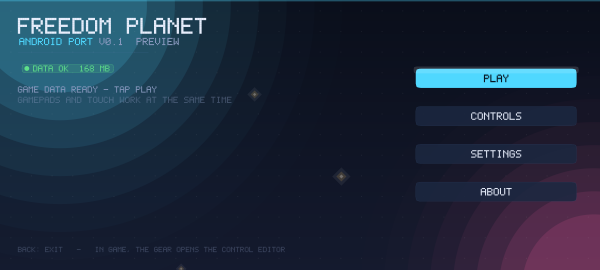
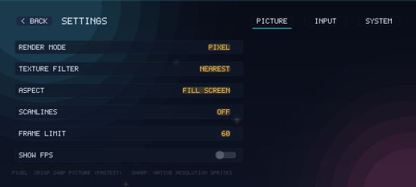
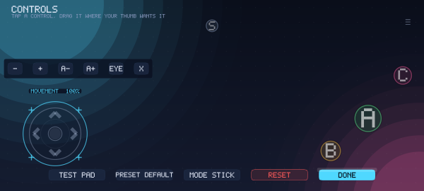
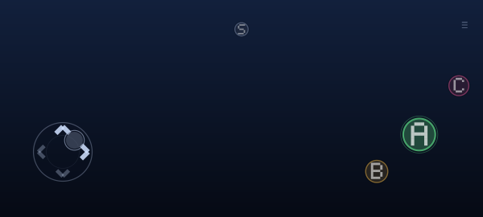
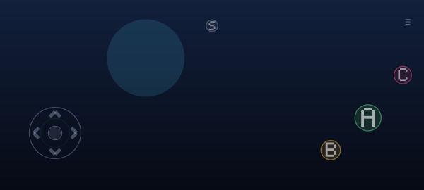

# Freedom Planet — Android port

A phone/tablet port of the same code base as the Dreamcast build. There is no emulator and no Java in the
game: `src/game` runs as-is, the picture goes through an OpenGL ES 3 renderer at the native 426×240 and is
upscaled on the GPU, and the port adds a launcher, editable touch controls and an audio mixer around it.

```
src/platform/android/plat_android.c   lifecycle, EGL, input (touch + gamepad), storage, the 60 Hz frame loop
src/platform/android/snd_android.c    AAudio mixer: AICA ADPCM decoding, 24 voices, streaming music
src/renderer/render_gles.c            r_* backend: paletted textures, ETC2, FBO upscale, blend modes
src/renderer/ui_gles.c                ui.h backend: the shell's immediate-mode UI (flat + SDF batches)
src/platform/android/{shell,launcher,ctl_editor,pad_draw,widgets,touch,cfg}.c   the shell
android/                              Gradle project, manifest, FpActivity.java, CMakeLists.txt
tools/android/                        host-side checks, the data packer, the font generator, NDK stubs
```

## What it looks like

The images below are rendered by the port's own UI code through the host backend
(`tools/preview/ui_soft.c`) — the same `shell.c` / `launcher.c` / `ctl_editor.c` / `pad_draw.c` that run on
the phone, so they show the real layouts:

| launcher | settings | controls editor |
|---|---|---|
|  |  |  |

| touch pad in game | in-game |
|---|---|
|  |  |

Regenerate them with `make -C tools/android preview`.

## Build

Requirements: Android Studio (or the command-line SDK + NDK 26/27 + CMake 3.22 + JDK 17).

```sh
cd android
gradle wrapper --gradle-version 8.7     # once (or just open the folder in Android Studio)
./gradlew assembleRelease               # -> app/build/outputs/apk/release/app-release.apk
./gradlew installRelease                # or run it straight onto a connected phone
```

`local.properties` needs `sdk.dir=...` (Android Studio writes it). ABIs built: `arm64-v8a`, `armeabi-v7a`,
`x86_64`. `minSdk 26` — AAudio, the low-latency output, starts there; GLES 3.0 is required by the
manifest and is universal since 2013.

### Installing an update: no uninstall

Every build is signed with the same key, `android/keystore/fpdc.p12` (a sideload key, committed on purpose:
Android refuses an update whose signature differs, and that is what forces an uninstall). `versionCode` grows
with the CI run number, so a new APK is always an *update*:

```sh
adb install -r app-release.apk          # debug and release share the key, so either can replace the other
```

The CI checks this on every build: it verifies both APKs, prints the certificate fingerprint and fails when
the two are not signed with the same key.

## Game data

The APK contains no Freedom Planet data. The game reads its assets from
`<external files dir>/data` (`/sdcard/Android/data/com.fpdc.port/files/data`):

1. One command on a PC converts your own `Assets.dat` (1.21.5) and packs it:
   `python3 tools/builder/fpbuild.py android "/path/Freedom Planet/Assets.dat"` →
   `build/builder/fpdc-data.zip` (20-60 min the first time, ~3 GB of disk; it downloads ffmpeg itself).
   Already have a converted data dir (from a CDI build)? `python3 tools/android/make_android_data.py
   build/builder/data -o fpdc-data.zip`.
2. Copy the zip anywhere on the phone, start the port, **IMPORT DATA**, pick the zip.

The importer unpacks into `data.tmp` and swaps the folder in at the end, so an interrupted import cannot
corrupt a working install; progress is shown in the launcher. A `data` folder copied by other means (file
manager, `adb push`) works too — the only thing the importer adds is the `.fpdc-data` marker with the size.
The port reads the same files the disc has (PAL8/PAL4/ARGB1555 atlases, AICA ADPCM sound effects, ADPCM
music), so the package is the Dreamcast `converted/` tree, unpacked.

## Controls

- **Touch pad**: floating analogue stick (it appears where the thumb lands), JUMP / ATTACK / SPECIAL /
  START / GUARD / GEAR. Sliding from one button to another re-targets the press; short taps are latched so a
  fast tap is never lost between frames. One vibration per press event, not per frame.
- **Editor**: the GEAR button in game, or CONTROLS in the launcher. Select a control, drag it (2.5 % grid),
  and the toolbar next to it sizes it / fades it. Presets (DEFAULT / LEFTY / COMPACT / BIG), TEST PAD, RESET.
  Everything is stored in `port.txt`, along with the per-control positions.
- **Gamepad**: any controller Android recognises (buttons, dpad, sticks, triggers) is ORed with the pad.

## Performance

- The view is rendered into a 426×240 texture and upscaled once per frame: fill cost drops by ~20× at 1080p
  and the pixel grid stays uniform (`render.mode = PIXEL`; `SHARP` draws straight at display scale).
- The upscale places the view with `present_geom.h` (one function for the rectangle and for the texture
  coordinates of that rectangle) — `tools/android/check_present.c` pins it. With `video.letterbox` the view
  keeps its exact 426×240 shape and the screen around it is filled with the same frame smeared and dimmed
  (no black bars, nothing stretched, nothing cut off); with it off the picture is stretched to the screen.
  The game's own SCREEN SIZE option (`r_set_letterbox`, a Dreamcast 4:3 thing) does not move the phone's
  presentation: use SETTINGS → ASPECT.
- Paletted atlases are uploaded as the index byte itself (`GL_R8`) with the level palette as a 256×4 lookup
  texture sampled with `texelFetch`: 8 bpp in texture memory, the same as the Dreamcast, no CPU conversion,
  and `r_pal_load` costs one 1 KB upload. ETC2 atlases (FPTX fmt 5/6) are also supported and uploaded as
  compressed blocks; they are optional, see below.
- One interleaved vertex buffer, quads batched per (texture, blend) with 16-bit indices: a game frame is a
  handful of draw calls. Draw order is the engine's submission order.
- The frame loop is a fixed 60 Hz accumulator: on a 90/120 Hz panel the game runs 60 update+draw pairs per
  second instead of double-stepping, and the 30 fps mode draws every other frame.
- Sound effects are decoded once at load (0.1–3 s each); music is decoded by a worker thread into a 1 s ring
  so the audio callback never touches the filesystem. AICA ADPCM is decoded in software with the hardware's
  step function (`aica_adpcm.h`): one byte is one stereo frame (high nibble left), two nibbles are two mono
  samples (low nibble first, as `wav2adpcm` packs them).
- One AAudio stream for the whole app: `snd_init_state()` returns the running stream instead of opening a
  second one (a second consumer of the same rings runs the music at double tempo and starves it). The
  stream is rebuilt if the device takes it away, and the delivery rate is measured once after four seconds:
  if a phone does not run at the rate it reports, the tempo follows the measured rate.
- The tempo chain is the stream rate, the source rate (music 32 kHz, effects 22.05 kHz) and the step per
  output frame; `tools/android/check_audio.c` pins it (a 0.1 s mix must consume 0.1 s of source), together
  with the stream lifetime and the ADPCM layouts.

## Settings (`port.txt`, in the app's internal files dir)

| key | default | |
|---|---|---|
| `render.mode` | 0 | 0 = 426×240 texture upscale, 1 = draw at display scale |
| `render.filter` | 0 | 0 = nearest (the pixel grid), 1 = smooth when upscaling |
| `video.letterbox` | 1 | keep the view's shape (0 = stretch to the screen) |
| `render.scanlines` | 0 | subtle 3-row scanlines |
| `render.fps` | 60 | 30 halves the draw rate |
| `sys.showfps` | 0 | FPS counter |
| `sys.keepon` | 1 | keep the screen on |
| `audio.music` / `audio.sfx` | 80 / 90 | master volumes (the game's own options still apply) |
| `pad.*` | | the touch layout written by the editor |

## Leaving the game

In game, the hardware BACK button or the pad's gear opens the pause menu: RESUME, CONTROLS, SHARE LOG,
COPY LOG, EXIT TO LAUNCHER. The menu freezes the game (`shell_game_paused()` also covers the controls
editor) and EXIT stops the engine on the next tick -- `shell_request_exit()` from the menu,
`shell_take_exit()` by the platform loop, then `engine_stop()` -- which drops back into the launcher with
the data and the save intact.

## The log (what to send when something is wrong)

Every line the port logs goes to `fpdc.log` twice: logcat (tag `fpdc`, `fpdc/ui`) and a file

```
/sdcard/Android/data/com.fpdc.port/files/fpdc.log          <- the current session
/sdcard/Android/data/com.fpdc.port/files/fpdc.prev.log     <- the session before it (a crash survives here)
```

Three ways to get it out: **COPY LOG** (clipboard, paste it into the chat), **SHARE LOG** (any messenger or
mail app) and **SAVE LOG AS .TXT** (Downloads), all on ABOUT and in the in-game pause menu. What they send is
the *previous* session's tail followed by this one, because after a crash the session that died is the one in
`fpdc.prev.log` -- a native crash (signal + `_Unwind_Backtrace` frames) and an uncaught Java exception both
append themselves to it. `sys.sndtrace` (SETTINGS -> SYSTEM -> SOUND TRACE) logs every voice start, which is
how a report about "extra sounds" says which sound it is.

The file starts with the device, the Android API level, the window in pixels and dp, and the data folder, then
one line per event with a relative timestamp, and every 150 frames a summary of what the renderer and the mixer
actually did:

```
frame 300: win 2652x1200 dp 3.25 ui 2652x1200, 812 quads + 63 sdf in 2 calls, glerr 0x0,
           game (mode 1 lvl dv1 p 1234,300 f 510, game 152 quads), rss 214 MB,
           snd 6 voices/0 underruns m_stage1.adp
```

The `game (...)` part is the engine's own state: the mode (`0` frontend, `1` a stage, `2` results, `4` ending,
`5` a story room), the level directory, the player position and the frame counter, then **how many quads the
game pushed into the frame** -- `0` means the picture is a bare clear, which is never a real frame (even a fade
to black draws its dimmer). Read it first when the screen is wrong: `0 quads` is a drawing problem, a `p` of
`nan` is a physics problem, and a plausible picture with 0 quads cannot happen.

(voices that keep counting up mean a sound that never ends -- that is what "extra sounds" looks like; underruns
counting up mean the audio callback is being starved; rss climbing means a leak or a texture that never goes away.)

If the engine draws nothing for a second, the port says so on screen instead of leaving a silent black screen:

```
NO PICTURE - REPORT IT (COPY LOG)
```

That banner is not a crash: the app is running, the touch pad works, and the engine produced no geometry. The
log then has a line `!! 60 frames with no geometry: mode ..., lvl ..., p ..., f ...` with the same state.

A native crash writes a self-contained block into the log before the system takes the process:

```
---- native crash: signal 11 at 0x77f6e45010, thread 12345 ----
     fault: outside the loaded modules (no module: heap, stack or unmapped)
     state: game, screen 2, pause 0, rss 214 MB, snd 6 voices / 0 underruns, music bgm/m_stage1.adp
     game: mode 1 lvl dv1 p 1234,300 f 510, 152 quads
  #00 0x752dfd2ab4  libc.so+0x9cab4
  #01 0x78dc3a7004  libfpdc.so+0x1a7004
  ...
     modules:
       libfpdc.so                   0x78c0000000-0x78c01b4000
       ...
```

The `<module>+<offset>` part is the point: the loader places every `.so` at a random address, so a bare address
means nothing. The APK ships `lib/arm64-v8a/libfpdc.so` unstripped for exactly this, so an offset resolves
offline against the same build:

```sh
unzip -p fpdc.apk lib/arm64-v8a/libfpdc.so > libfpdc.so
addr2line -f -C -e libfpdc.so 0x1a7004
```

An uncaught Java exception is appended as a stack trace, and a native crash leaves its last lines in
`fpdc.prev.log` after the restart.

**ABOUT -> SHARE LOG FILE** hands the file to any messenger or mail app (it is sent as text, so no file
permissions are involved). The same file can be pulled over USB/adb:

```sh
adb pull /sdcard/Android/data/com.fpdc.port/files/fpdc.log
```

## Prebuilt APK (CI)

Every push builds the port with the real NDK — [`.github/workflows/android.yml`](../.github/workflows/android.yml).
A successful run leaves the APKs in the `fpdc-apk` artifact of its *Build APK* job (download it from the run's
Artifacts section) and installs over the previous version (see *Installing an update* above).

The workflow has two jobs, and it does not run anything on an emulator — the port is tested on a real phone:

| job | what it does |
| --- | --- |
| `checks` | the host checks below: the GLES sources compile against the stub NDK headers, every launcher screen renders to PNG, the colour packing and the draw order of the GLES backend are pinned by tests, and a selftest taps through the launcher (PLAY, the tabs, a row, a switch, a slider) checking that each one reacts |
| `apk` | `sdkmanager` installs the SDK/NDK/CMake, Gradle 8.7 builds `assembleDebug assembleRelease`, then both APKs are inspected: `lib/*/libfpdc.so` and `classes.dex` present, signed, and the two certificate fingerprints identical (that is what makes an update install without an uninstall) |

## Verified / not verified

Runs on a plain Linux host without the NDK or a device:

```sh
make -C tools/android check      # syntax + twiddle + font + preview build
make -C tools/android preview    # every launcher/editor/in-game screen as PNG
```

`check` compiles the two GLES backends and the platform layer with `-Wall -Wextra` against the stub headers in
`tools/android/ndkstub/`, verifies `fp_untwiddle_offset()` against `tools/twiddle_disc.py` for 15 atlas shapes,
checks the generated 5×7 font, and builds the shell against the host UI backend.

Verified by CI: the NDK build of all three ABIs, both APKs carrying `libfpdc.so` and `classes.dex`, the
signature being identical across builds, and the host checks above.

**Verified on a phone by hand** (that is the point of the log): the launcher, the controls editor, the
settings, the import of the data package, touch and gamepad input, and the game itself. The host tests catch
the two whole classes of bug that only showed up on a phone so far: the GLES backend drew every rounded panel
*over* the text (so button labels were invisible), and a tap that started the launcher's PLAY button went to an
empty stub. `make -C tools/android check` runs both.

**Not verified by CI at all:** anything that needs a device — AAudio latency, the real touch feel, thermals,
and the GPU-specific rendering. That is why the log exists: `ADB`/`SHARE LOG FILE`, and the numbers in it
(window, dp, ui target, quads, GL errors) say what the renderer did on that phone.

## Why ETC2 is optional

The disc's atlases are 8-bit paletted. Uploading the index byte and looking the colour up in a 256×4 palette
texture costs 8 bpp — exactly what the Dreamcast used — is lossless, needs no CPU pass at load, and makes a
palette change a 1 KB upload. ETC2 would halve the memory (4 bpp) but throws the palette away: every atlas has
to be converted offline (and re-converted if the palette changes), and the picture gains ETC2's block
artefacts on the gradients the pixel-art look depends on. Since the renderer already supports both, ETC2 can be
added later for the handful of large background atlases where bandwidth might matter on a very weak GPU;
nothing else needs it.
